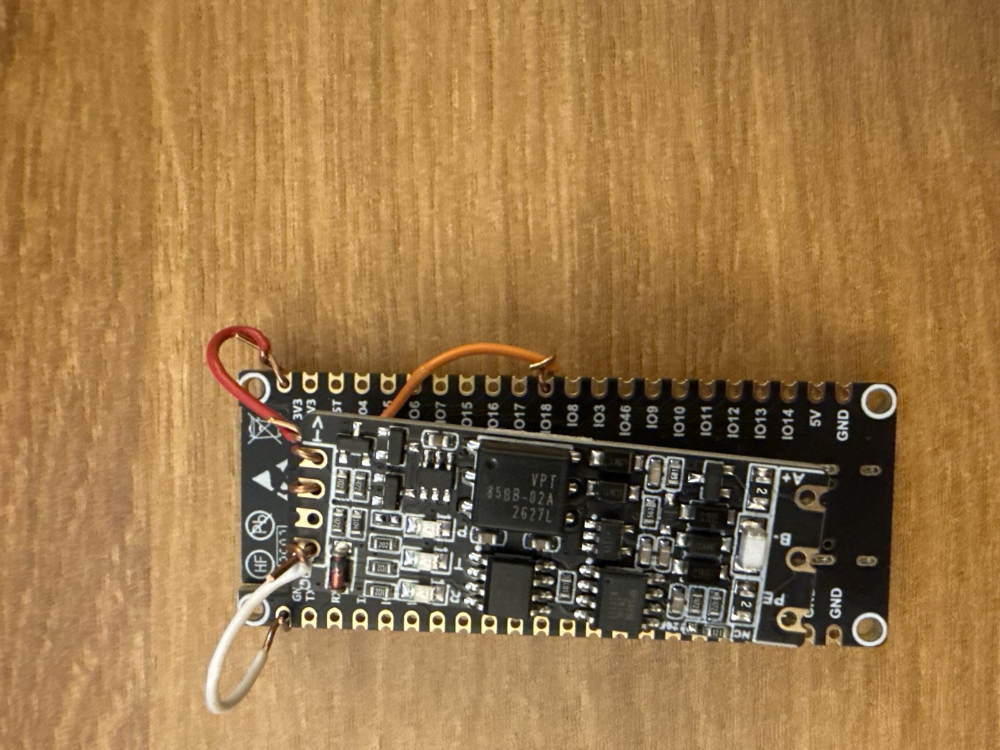
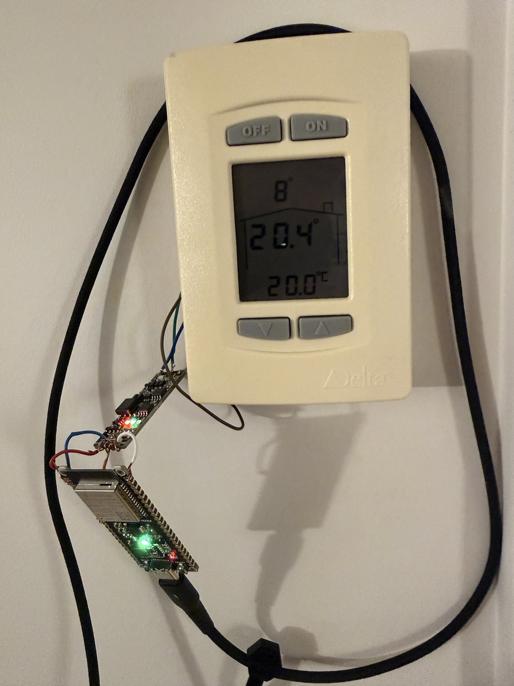
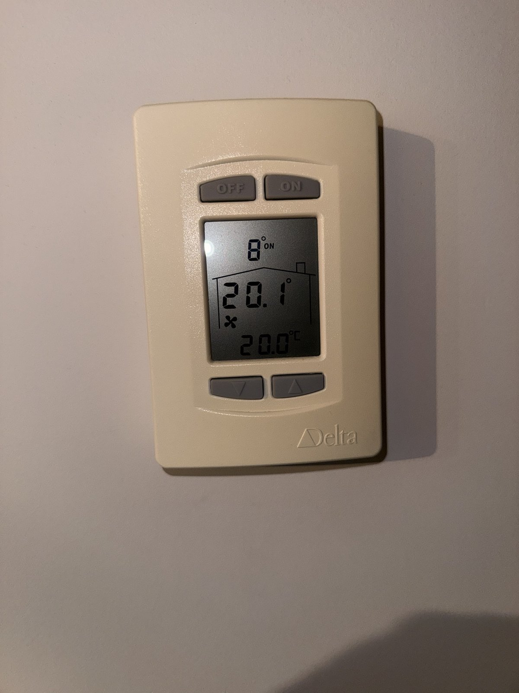

# Hardware: listening to LINKnet safely

Two ways to listen to the bus, both **receive-only**:

- **Phase 1:** a USB RS-485 adapter on a computer, with `tools/usb/capture.py`.
- **Phase 2:** an ESP32-S3 with an isolated RS-485 module and the firmware in `firmware/`.

## Safety rules

The bus runs the heating and cooling of an occupied home. A single byte on the wire at the wrong time can
disturb it, so these rules come first.

1. **Nothing must be able to reach the bus, by design.**
   - **Hardware:** the RS-485 module chosen here switches direction by itself. A low level on its `RXD` input *is* a
     transmission. That pin is therefore **tied to the module's own `VCC`** and never wired to the ESP32.
   - **Software:** the bus UART has a receive pin and no transmit pin (`UART_PIN_NO_CHANGE`), and no code writes to it.
     GPIO 17, UART1's default TX, is neither configured nor wired.
   - At boot, the firmware reads the pin registers back and refuses to listen if any of this is not so (`firmware/src/main.cpp`).
2. **No pull-down** on the ESP32 receive pin: an internal pull-up keeps the line idle when the module is unplugged.
3. **Watch the module's LEDs:** **P** on, **T** blinking with the traffic, **R off at all times**. If R lights up, unplug the
   module.
4. If a thermostat shows an error or seems to lose communication, unplug the module.
5. **Do not use UART0 or its pins** (boot log and USB console) for the bus, and avoid the strapping pins.
6. **Never transmit without a plan.** Write down, byte by byte, what would be sent and why, and when it fits in the token
   timing (report, section 11).

## Parts

| Part | Notes |
|---|---|
| Waveshare **ESP32-S3-DEV-KIT-N8R8** | ESP32-S3-WROOM-1-N8R8; one USB-C connector: CH343P bridge on UART0 plus native USB |
| Waveshare **TTL TO RS485 (C)** | isolated; SP3485E; automatic direction; P/T/R LEDs; 120 Ω termination left **off** |
| A few short wires | 3V3, GND, GPIO18, and the `RXD`–`VCC` jumper on the module |
| A 5 V USB-C supply | the board runs from it; console and updates go over Wi-Fi |

For phase 1, any USB RS-485 adapter with automatic direction works (the original one used an FTDI chip), wired the same way
on the RS-485 side.

## Wiring

| From | To |
|---|---|
| ESP32 `3V3` | module `VCC` |
| ESP32 `GND` | module `GND` |
| ESP32 `GPIO18` (UART1 receive) | module **`TXD`**: the module's *output*, what it hears on the bus |
| module **`RXD`** | module **`VCC`**: short jumper, so the module can never transmit |
| module `A+` | thermostat `NET +` |
| module `B−` | thermostat `NET −` |
| module `PE` | thermostat `GND`: the isolated RS-485 signal ground |
| nothing | the thermostat's `24~` (power), ESP32 `GPIO17` |

Wire the TTL side first with the ESP32 unpowered, then the `RXD`–`VCC` jumper, then the RS-485 side last.
After power-up, check the LEDs (rule 3) and both thermostats.

The module's pin names follow *its* point of view: its `TXD` sends to the microcontroller, its `RXD` receives from it.
Getting this backwards wires the ESP32's transmit side to the bus.

The bus already has bias resistors on the module and needs no termination (three nodes). Measured with the module
unplugged: 9.54 kΩ between `A+` and `B−`, which means the termination is off.

### Photos

*The module stacked on the ESP32 board, with insulation between the two boards. Red: 3V3 → VCC; orange: IO18 → TXD;
white: GND → GND. This photo was taken **before** the `RXD`–`VCC` jumper was added. Always fit that jumper.*

*Thermostat 1 with the listener on its terminals. The ESP32 runs from a USB supply. The RS-485 wires keep the thermostat
from closing flush in its case.*

*Thermostat 2, showing the fan icon and the word “ON”, both sent by the controller in service 13 (bytes 39 and 43).*

## ESP32 pins

| Pin | Use |
|---|---|
| GPIO18 | UART1 receive, input with pull-up, never a pull-down |
| GPIO17 | unused and unwired: UART1's default TX |
| GPIO38 | on-board RGB status LED |
| GPIO43/44 | UART0: boot log and USB console, never the bus |
| 0, 3, 45, 46 / 19, 20 / 35–37 | avoided: strapping pins / native USB / octal PSRAM |

The reasons and sources for each choice are in `firmware/include/BoardConfig.h`.
