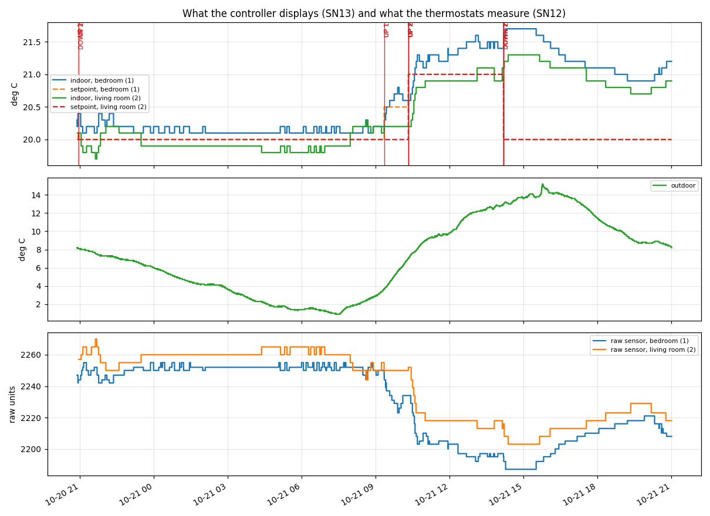
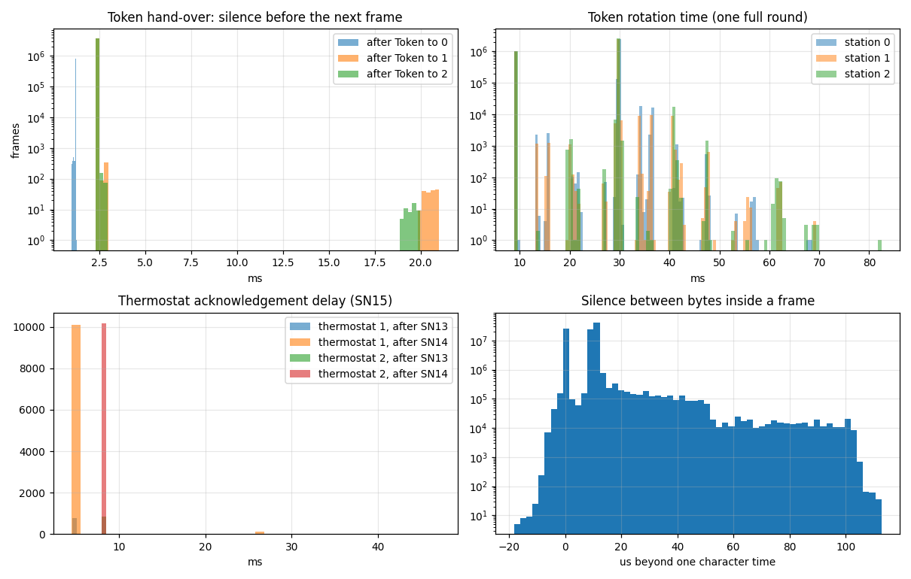
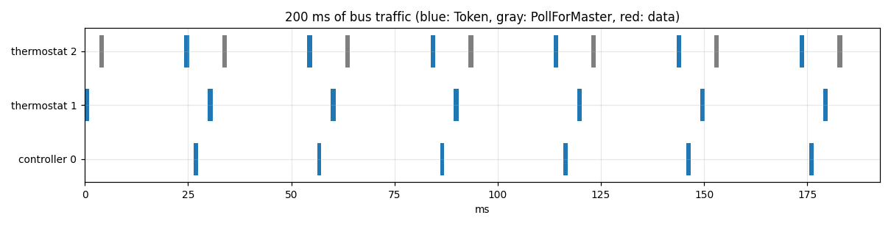

# Delta Controls DNS-24L thermostats on LINKnet: reverse-engineering report

This report describes the bus between a Delta Controls HVAC controller and two **DNS-24L** wall thermostats,
as observed by listening only. Nothing was ever transmitted on the bus.

- **Phase 1 (2026-10-16):** 30 minutes recorded through a USB RS-485 adapter, plus scripted tests on the
  thermostats. Timestamps have ~16 ms resolution, the latency timer of the adapter's FTDI chip.
- **Phase 2 (2026-10-17 to 2026-10-21):** an ESP32-S3 listening through an isolated RS-485 module, with
  each byte stamped in microseconds. Validation tests and a 24-hour recording.

Section numbers are stable: the firmware's comments cite them.

**Setup.** A multizone fan-coil unit has a built-in Delta Controls controller. Its model is unknown, and the
controller was not opened. Two DNS-24L thermostats are wired to it: thermostat 1 in a bedroom, thermostat 2 in a living room.

## Contents

1. [Protocol](#1-protocol)
2. [Devices and addresses](#2-devices-and-addresses)
3. [Traffic pattern](#3-traffic-pattern)
4. [The Delta private messages](#4-the-delta-private-messages)
5. [Are both thermostats on the same bus?](#5-are-both-thermostats-on-the-same-bus)
6. [How the controller learns about a key press](#6-how-the-controller-learns-about-a-key-press)
7. [Ways to write to the system](#7-ways-to-write-to-the-system)
8. [Possible next steps](#8-possible-next-steps)
9. [Decoding rules](#9-decoding-rules)
10. [Phase 2 hardware](#10-phase-2-hardware)
11. [Phase 2 results](#11-phase-2-results)
12. [Public Delta documentation](#12-public-delta-documentation)

## 1. Protocol

Delta calls this bus **LINKnet**. On the wire it is **standard BACnet MS/TP** at 76 800 baud, 8N1.

- Phase 1 recorded 284 322 frames, and **no CRC was invalid**, neither in the headers nor in the data.
  Phase 2 recorded 13.5 million frames over 24 hours, again with no CRC error.
- Every frame starts with the `55 FF` preamble. A pcap with linktype 165 decodes cleanly in Wireshark 4.6.
- The network layer is a plain BACnet NPDU, `01 00`, without routing.
- The application layer is **proprietary**. Every data message between the controller and the thermostats is
  an `UnconfirmedPrivateTransfer` (`10 04`) from vendor **8, Delta Controls**.
- Phase 1 saw **no standard BACnet service**: no Who-Is, I-Am, ReadProperty or WriteProperty.
  The longer phase 2 recording found one exception, an hourly *TimeSynchronization* broadcast by the
  controller (section 11).

The common shape of every data frame (MS/TP frame type 6, *Data Not Expecting Reply*):

```
01 00 | 10 04 | 09 08 | 19 <SN> | 2e 6x <len> <octet string> 2f
NPDU    UPT    vendor=8  service  parameters = one octet string
```

## 2. Devices and addresses

| MS/TP MAC | Device | Role |
|---|---|---|
| 0 | Delta controller, inside the fan-coil unit | master; sends services 13 and 14 |
| 1 | Thermostat 1, bedroom (DIP `1000`) | master; sends services 12 and 15 |
| 2 | Thermostat 2, living room (DIP `0100`) | master; sends services 12 and 15; last master (next station = 0) |

- DIP switch 1 is the least significant bit: `1000` gives address 1, `0100` address 2.
- There is no slave and no other master: thermostat 2 polls addresses 3 to 127 and never gets an answer.
- Both thermostats are **full MS/TP masters** that receive the token.

## 3. Traffic pattern

- **Token:** it circulates 0 → 1 → 2 → 0, about 42 times a second, so about 24 ms a round.
- **Poll For Master:** thermostat 2 polls a new address on almost every round. It sweeps addresses 3 to 127 in about 4.2 s.
- **Service 14 (poll):** the controller polls each thermostat every **8.5 s**. Thermostat 2 is polled
  about 0.8 s after thermostat 1.
- **Service 13 (display):** the controller sends it right after each service 12, within 0.1 to 0.7 s, and whenever a
  displayed value changes. Phase 1 suggested an extra refresh every ~30 s. The 24-hour recording of phase 2
  shows that this refresh does not exist: the longest silence for one zone was 15.5 minutes (section 11).
- **Service 12 (reading or key):** the thermostat sends it on its own:
  - when its reading moves by about 5 raw units, roughly 0.1 °C;
  - immediately, on each key press.
- **Total traffic:** about 1.26 kB/s, or 16 to 17 % of the bus capacity.

## 4. The Delta private messages

Bytes are numbered from 0 within the octet string, after `6x <len>`.

**SN 14: poll, from the controller to a thermostat** (3 bytes): `00 <seq LE 16 bits>`.
The `seq` counter is shared by every service 13 and 14, to both thermostats.

**SN 15: reply, from the thermostat to the controller** (6 bytes): `<addr> 00 <seq LE> <status> 00`.
The thermostat echoes the counter it received. The status is `02` after a service 14 and `03` after a
service 13. It is an acknowledgement.

**SN 12: from the thermostat to the controller** (45 bytes):

| Byte | Content |
|---|---|
| 1 | thermostat address (01 or 02) |
| 2 | `02`, constant |
| 3 | `01` = periodic reading; `00` = key press |
| **5–6** | **raw sensor reading**, 16-bit little-endian, around 0x0880 to 0x08B0 |
| 39 | key mask: OFF `01`, ▼ `02`, ON `04`, ▲ `08` |
| 41 | key number: OFF 1, ON 2, ▼ 3, ▲ 4 |
| others | `00` in every capture so far |

**The raw value goes down when the temperature goes up**, as for an NTC thermistor.
In phase 1 test 5 (a hand on the sensor), it went from 2213 to 2182 while the display rose from 21.1 to 21.8 °C.
That is about −40 units per °C around 21 °C. The controller does the conversion to °C.

**SN 13: display, from the controller to a thermostat** (56 bytes):

| Byte | Content |
|---|---|
| 6–13 | **outdoor temperature**, ASCII text, NUL-padded (`5.3`) |
| **14–21** | **indoor temperature**, ASCII text (`21.3`) |
| **22–29** | **setpoint**, ASCII text (`20.0`) |
| 38 | `01`, constant |
| 39 | **fan icon** (1 = shown); see sections 6 and 11 |
| 43 | **“ON” word** (1 = shown; thermostat 2 goes to 0 after OFF and back to 1 after ON) |
| 45 | `ff` for about 8 to 30 s after a key press, otherwise `00` (adjust mode) |
| 49–50 | the same `seq` counter as in service 14 |
| 53–55 | `01 01 02`, constant |

The thermostat **only shows what the controller sends**. It rounds the outdoor temperature
itself: the screen shows 5 for `5.3`, and 8 for `8.1`.

## 5. Are both thermostats on the same bus?

**Yes.** The adapter is wired at thermostat 1, and the traffic of thermostat 2 (address 2) is seen live.
Its ▲ and ▼ presses produced services 12 from address 02, and the controller updated the living-room setpoint
independently of the bedroom one.

## 6. How the controller learns about a key press

The thermostat keeps **neither setpoint nor state**:

1. On its next token, the thermostat **sends a service 12 on its own**. Byte 3 is `00`, and bytes 39 and 41 carry the key.
   It does not wait for the service 14 poll.
2. The controller applies the key in its own logic: ±0.1 °C on the setpoint, or on/off.
3. Within 0.1 to 0.7 s, the controller sends back a service 13 with the new setpoint as text, and byte 45 goes to `ff`.
4. The thermostat acknowledges it with a service 15 (status `03`).

Thermostat 1 does send ON and OFF, but **the controller ignores them for the bedroom**: bytes 39 and 43 stay at 0
and the screen does not change. This is a choice in the controller's program.

**Fan icon (byte 39 of service 13), phase 1.** After the OFF/ON tests, byte 39 of the living room stayed at 0. Lowering
the living-room setpoint brought the icon back, at a setpoint of **19.4 with the room at 20.9**:

| Moment | Room | Setpoint | Difference | Fan |
|---|---|---|---|---|
| Start | 21.6 | 20.0 | 1.6 | yes |
| After OFF/ON | 20.8 | 20.0 | 0.8 | no |
| Setpoint lowered | 20.9 | 19.4 | 1.5 | yes |

The icon then stayed on with the setpoint back at 20.0 and the room at 21.1, so there is **hysteresis**: the demand stops
at a smaller difference than the one that starts it. Phase 2 saw the same icon follow a heating demand
(section 11). The icon most likely shows that the fan is running, for heating or cooling.

**Reference state** used in all tests: both setpoints at 20.0. The living room shows the fan and “ON”. The bedroom shows neither.

## 7. Ways to write to the system

The mechanism is clear: the thermostat reports its keys, and the setpoint lives in the controller.
There are three ways to change a setpoint:

- **A. Standard BACnet requests to the controller: possible, not proven.** On this port the controller speaks only
  Delta's private protocol (plus the time broadcast). Nothing shows that it would answer a Who-Is or a ReadProperty on its
  LINKnet port. Finding out takes at least one transmitted Who-Is.
- **B. Man in the middle on the cable: feasible, but heavy.** It needs two RS-485 transceivers, a cut cable, and every frame
  relayed within the MS/TP timing. Option C makes it unnecessary.
- **C. Joining the token ring: the most promising.** Thermostat 2 keeps polling addresses 3 to 127. A device that
  answers at address 3 would be admitted into the ring, as the standard intends. Then:
  - **Reading** is already possible passively: the raw temperature (service 12), or the temperature in °C and the setpoint as text (service 13).
  - **Writing:** send services 12 with the ▲ or ▼ key and the thermostat's address in byte 1. Then close the loop by reading the setpoint
    from service 13. For example, going from 20.0 to 22.0 takes 20 simulated presses, at least 10 to 20 s (see the
    spacing rule in section 11).
  - **Main unknown:** does the controller identify the thermostat by the MS/TP source address of the frame, or by byte 1
    of the octet string? In the first case, a frame from address 3 would be ignored.

## 8. Possible next steps

None of these has been done. Each transmission must be planned byte by byte beforehand.

1. Expose the decoded data over Wi-Fi, still listening only (JSON, MQTT, Home Assistant).
2. A native-tested MS/TP master state machine for address 3: answer Poll For Master, pass the token within the timing
   measured in section 11, and never send outside the token.
3. First transmission: answer *Reply To Poll For Master* at address 3, then hand the token on at once. Check that the
   thermostats show no error.
4. Send a global Who-Is (`01 20 ff ff 00 ff 10 08`) and see whether the controller answers with an I-Am. If it does, its
   object list opens option A.
5. Otherwise, send a single service 12 with the ▲ key and address 01, from address 3. Check that the bedroom setpoint
   goes to 20.1, then bring it back with ▼.
6. Only if 4 and 5 fail: consider option B.

## 9. Decoding rules

**Reference material** (in this repository):
- `docs/example-frames.md`: one complete frame of each kind, CRCs included.
- `tools/usb/mstp.py`: reference implementation of both CRCs (header CRC-8, data CRC-16) and of the framing.
- `captures/phase1-usb/20261016-211923.bin` and `.log`: about 28 minutes of bus, with the test markers in the `.log`.
  The firmware's tests replay it and compare against `expected_summary.txt` and `expected_delta_messages.csv`.
- `captures/phase1-usb/calibration.csv`: 50 pairs of service-12 raw value and service-13 displayed temperature.
  Over the observed range (raw 2174 to 2223, 21.0 to 22.0 °C), **temp ≈ 74.52 − 0.02416 × raw**, within ±0.17 °C.
  The sensor is a thermistor, so the relation is not linear: **do not extrapolate**. Prefer the °C text of service 13.

**Rules:**
- To split the stream, look for `55 FF`, check the header CRC-8, read the big-endian length, then check the data CRC-16.
  Ignore any invalid frame.
- Keep the type-6 frames whose data starts with `01 00 10 04 09 08 19`, then read the service number.
- In service 13, the text fields are 8-byte strings, left-aligned and NUL-padded, at bytes 6, 14 and 22. Expect **negative**
  outdoor temperatures (`-12.5`), not observed yet.
- A zone's setpoint is found **only** in the service 13 sent to that zone (destination 1 or 2).

## 10. Phase 2 hardware

### Isolated RS-485 module (Waveshare TTL TO RS485 (C))

On the board: an **SP3485E** transceiver (3.3 V, half duplex), a two-channel digital isolator, an isolated DC-DC converter,
a TVS diode, and three LEDs (P, T, R).

| Pin | Role | Use here |
|---|---|---|
| `VCC` | supply, 3.3 to 5 V | ESP32 **3V3**: TTL levels are then 3.3 V |
| `GND` | TTL-side ground | ESP32 GND |
| **`TXD`** | the module's **output**: what it receives from the bus | **→ ESP32 GPIO 18** (receive) |
| **`RXD`** | the module's **input**: what it would transmit on the bus | **never wired to the ESP32**; tied to `VCC` |
| `A+` | RS-485 A+ | thermostat `NET +` |
| `B−` | RS-485 B− | thermostat `NET −` |
| `PE` | isolated RS-485 signal ground | thermostat `GND` |

**The pin names are counter-intuitive.** They follow the module's point of view: the MCU's RX goes to the module's TXD.
The **T** LED blinks when the module passes bus data to the MCU. The **R** LED lights when it gets data to transmit.
**When listening only, R must stay off.**

**Automatic direction.** The module has no DE/RE pin: a low level on `RXD` *is* a transmission. A floating `RXD` could pick up
noise and jam the bus. Tying `RXD` straight to the module's `VCC` keeps it at the UART idle level, so nothing can be transmitted.

**Termination.** The module has a 120 Ω termination selected by a solder jumper. With the module unplugged, we measured
9.54 kΩ between `A+` and `B−`. The termination is off, and the value matches the two 4.7 kΩ bias resistors in series.
This bus has only three nodes, so it needs no termination.

### ESP32-S3 board (Waveshare ESP32-S3-DEV-KIT-N8R8)

- ESP32-S3-WROOM-1-N8R8 module: 8 MB quad flash, 8 MB **octal** PSRAM; pin-compatible with Espressif's DevKitC-1.
- One USB-C connector behind a hub: a CH343P USB-UART bridge on UART0 (GPIO43/44, with auto-program), and the native USB (GPIO19/20).
- WS2812B RGB LED on **GPIO38**.
- **Pins avoided:** 0, 3, 45, 46 (strapping); 19, 20 (USB); 43, 44 (UART0 console); 35, 36, 37 (octal PSRAM on this
  module); 38 (LED).
- **Bus receive: GPIO 18**, U1RXD in the IO MUX, as an input with pull-up and **never** a pull-down. GPIO 17 (U1TXD) stays
  unconfigured and unwired; UART1 is set up with RX = 18 and TX = `UART_PIN_NO_CHANGE`.

Wiring, photos and safety rules: [hardware.md](hardware.md).

## 11. Phase 2 results

### Validation

1. **Decoded values against the screens: identical.**
   - Bedroom: 20.2 / 20.0 / 8.1, no fan, no “ON”.
   - Living room: 20.1 / 20.0 / 8.2, fan and “ON”.
   - The screens show the outdoor temperature rounded to “8”.
2. **One ▲ then one ▼ on each thermostat: as expected.**
   - The ESP32 sees the key (mask `08`, then `02`), then the new setpoint 0.28 to 0.49 s later.
   - Byte 45 goes back to `00` about 8 s after the key.
3. **Endurance:**

   | 24 hours (2026-10-20 20:51 to 2026-10-21 21:01) | |
   |---|---|
   | Frames | 13 555 666 |
   | Bytes | 109 352 348 |
   | Header or data CRC errors | 0 |
   | Bytes outside frames, UART errors | 0 |
   | `seq` gaps, unacknowledged services 13/14 | 0 |
   | Bus load | 16.4 %, 1 257 B/s |
   | Token retries | 221: 172 to thermostat 1, 49 to thermostat 2; 5 to 15 an hour, at any hour |



*Top: indoor temperatures and setpoints shown by the controller (service 13), with the key presses. Middle: outdoor
temperature. Bottom: raw sensor readings (service 12).*

### Inter-frame timing

Each value runs from the end of the last byte of a frame to the start of the first byte of the next one. One character lasts
130.2 µs at 76 800 baud. The figures come from the 24-hour recording.

| Delay | n | min | median | p99 | max |
|---|---|---|---|---|---|
| Token received → first frame of the **controller** (0) | 3.64 M | 1.005 ms | 1.22 ms | 1.23 ms | 1.26 ms |
| Token received → first frame of **thermostat 1** | 3.64 M | 2.29 ms | 2.32 ms | 2.39 ms | 21.0 ms¹ |
| Token received → first frame of **thermostat 2** | 3.64 M | 2.29 ms | 2.36 ms | 2.39 ms | 20.0 ms¹ |
| Controller data frame → next frame | 22 094 | 1.01 ms | 1.24 ms | 1.24 ms | 1.25 ms |
| Thermostat data frame → next frame | ~11 200 | 2.25 ms | 2.28–2.32 ms | 2.35 ms | 2.45 ms |
| Unanswered Poll For Master → next token | 2.59 M | 18.9 ms | 19.5 ms | 19.6 ms | 20.0 ms |
| Unanswered token → token retry | 221 | 19.0 ms | 19.5 ms | 21.0 ms | 21.0 ms |
| Full token rotation | 3.64 M | 8.9 ms | 29.8 ms | 34.2 ms | 82 ms |
| Service 13/14 → acknowledgement (SN 15), thermostat 1 | ~11 000 | 4.5 ms | 4.74 ms | 26 ms² | 47 ms |
| Service 13/14 → acknowledgement (SN 15), thermostat 2 | ~11 070 | 7.9 ms | 8.19 ms | 8.3 ms | 30 ms |
| Silence between two bytes of one frame, beyond one character | 95.8 M | 0 | 10 µs | 38 µs | 113 µs |

¹ Token retries. ² A few dozen late acknowledgements around 26 ms, probably the same cause as the token retries to thermostat 1.





**What this means for a future transmitting station:**
- The controller answers in 1.2 ms and the thermostats in 2.3 ms. Every reply is far inside the MS/TP Treply_delay of 250 ms.
- An unanswered token is retried after 19 to 21 ms (Tusage_timeout).
- Inside a frame, no sender leaves more than 113 µs between two characters.
- A token round takes 8.9 ms without Poll For Master and about 30 ms with one. The mean is 23.9 ms, the phase 1 figure.
- Thermostat 2 acknowledges 3.4 ms later than thermostat 1: it has to wait for the token to pass through thermostat 1.

### Findings that complete or correct phase 1

- **Service 13 is not periodic.**
  - The controller sends it when a displayed value changes and after each service 12. Its longest silence for one zone was 15.5 min.
  - A listener can therefore wait minutes before it knows a zone. The firmware's 90 s staleness threshold is too short: about 20 min fits.
  - Service 14 is periodic, every ~8.5 s.
- **The controller broadcasts the time.** This is a **standard** BACnet service.
  - Every hour at about HH:12, the controller sends a *TimeSynchronization* (`10 06`) to address 255.
  - Example: `a4 7e 0a 14 02` is Tuesday 2026-10-20, and `b4 15 0c 07 56` is 21:12:07.86.
  - Over 24 hours there were 26 broadcasts: one an hour, plus two outside the cycle (10:05:26 and 12:59:59), for unknown reasons.
  - The clock is set to local time, 1 to 4.7 s behind the host. The date rolls over correctly at midnight.
- **The controller follows no setpoint schedule.** In 24 hours, the setpoints changed only on our key presses.
- **The controller can drop a key press that comes too soon after another.**
  - In 11 quick ▲ presses on thermostat 2, all 11 services 12 were on the bus and valid, but the setpoint rose by 10 steps only.
  - From the sequence of services 13, the lost press is one of two sent 196 ms apart. Other pairs as close did count.
  - The controller's program most likely reads its `KeyPress` value once per scan, so a second press within the same scan
    overwrites the first.
  - When simulating presses, space them by 0.5 to 1 s and check the setpoint in service 13 after each one.
- **Fan icon.**
  - The living-room icon went off for a few seconds and back on 100 times during the night, most often when it was coldest outside.
  - While the setpoint was being lowered from 21.0 to 20.0, the icon went off as soon as the setpoint dropped to 20.7 with the room
    at 21.1, and it stayed off while the room was above its setpoint.
  - With section 6, this suggests that the icon shows the fan running, with a few tenths of a degree of hysteresis.
- **Token retries.**
  - 221 in 24 hours, steady. Phase 1 saw 4, all to thermostat 1. The ring always resumes on the next round, no message is lost,
    and no thermostat shows an error.
  - The cause is unknown. One candidate: in phase 2 the RS-485 wires keep thermostat 1 from closing fully in its case.
  - Either way, the controller tolerates occasional missing answers on its network.
- **Phase 1 reference capture.**
  - Replayed through the firmware decoder, it gives exactly 284 322 frames and no CRC error.
  - The original phase 1 listing dropped the leading `00` of the service 14 strings because of a framing bug.
    `expected_delta_messages.csv` keeps that quirk, and the replay test allows for it.
  - The phase 1 “ring breaks” are ordinary MS/TP token retries.

## 12. Public Delta documentation

Delta's public product documents for the DNS-24L (installation guide and catalog sheet; the documents themselves are not
reproduced here) confirm or complement the observations:

- The bus is **LINKnet**, RS-485: 76 800 baud by default (38 400 with DIP switch 8), addresses 1 to 12 set with DIP switches 1
  to 4, at most 12 devices depending on the controller.
- The thermostat is a programmable display. The controller holds an LCD object for it, which its program fills in. It has three
  value lines with their units, plus icon properties: occupancy, sun/moon, fan level 0 to 4, heating, cooling, humidity,
  calibrate, on, off, time, minimum, maximum, set. This is what service 13 carries. The order of these properties is a lead for
  naming the service 13 bytes that are still unidentified.
- **Keys:** the LCD object exposes a key-press value with OFF = 1, ON = 2, ▼ = 3, ▲ = 4, and two-key combinations. This matches
  byte 41 of service 12. Byte 39 carries a bit mask instead.
- **Sensor:** an internal 10 kΩ thermistor, ±0.2 °C. An external thermistor replaces it when connected. The conversion to °C
  happens in the controller, which explains why service 12 carries a raw value.
- **RJ11 jack under the thermostat:** a service port for Delta's service tools (for example a Bluetooth adapter for the
  building network). Its pinout is not published. We measured it: GND, not connected, NET−, NET+, 24 V, GND on pins 1 to
  6 ([hardware.md](hardware.md#rj11-service-port)).
- **Power:** 24 V AC or DC, 1.5 VA. Several Delta devices may share one transformer if the polarity of `24~` and `GND` is
  the same on all of them. Devices with full-wave (bridge) rectification must not share it.
- Recommended cabling: shielded twisted pair, 100 to 120 Ω. No termination below three nodes.
